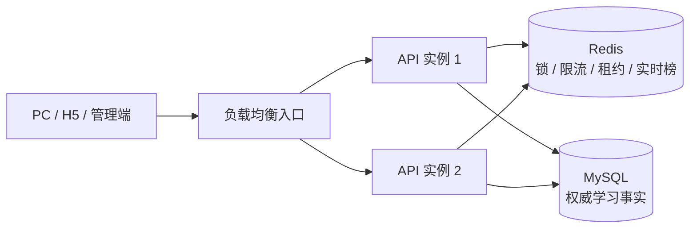

# PlayEdu 二次开发项目

基于 PlayEdu 开源版进行二次开发的企业培训平台，重点扩展分布式学习状态管理、实时学习排行榜与积分兑换功能。

本仓库由 yjhaes 在 [PlayEdu 开源项目](https://github.com/PlayEdu/PlayEdu)基础上维护，保留管理后台、PC 学员端和 H5 学员端。上游提供基础培训业务，本仓库在此基础上扩展业务功能与后端实现；这是个人维护的二次开发版本，与上游官方版本分别维护。原项目版权声明、页面版权信息与许可证保持不变。

[贡献指南](CONTRIBUTING.md) · [项目文档](docs/README.md) · [更新记录](CHANGELOG.md) · [安全报告](.github/SECURITY.md) · [许可证](LICENSE)

## 项目结构

| 目录 | 用途 |
| --- | --- |
| `playedu-api/` | Maven 多模块后端：API、common、system、course、resource、points |
| `playedu-admin/` | React 管理后台 |
| `playedu-pc/` | React PC 学员端 |
| `playedu-h5/` | React H5 学员端 |
| `docker/` | MySQL、Nginx 与双实例验收配置 |
| `scripts/` | 可复用验收脚本 |
| `docs/` | 架构决策、开发指南与验收文档 |
| `.scratch/` | 功能规格、任务与验证记录；临时实验由忽略规则排除 |

## 功能来源与二次开发范围

| 来源 | 内容 |
| --- | --- |
| 上游基础功能 | 部门与学员管理、课程与课时管理、在线视频学习、学习进度追踪、资源管理及三端页面 |
| 分布式学习状态扩展 | 使用 Redis 管理跨实例锁、共享限流、登录失败计数和活跃学习租约，学习事实保存在 MySQL |
| 实时学习排行榜扩展 | 以 Redis 提供每日学习榜查询，支持从 MySQL 重建榜单 |
| 积分业务扩展 | 首次完成课程奖励、积分流水、商品与兑换码库存、积分兑换，以及管理后台和 PC/H5 积分中心 |
| 工程与验收配套 | Docker Compose 部署、双 API 实例验收拓扑、验收脚本及架构决策文档 |

技术栈：Java 17、Spring Boot 3、MyBatis-Plus、MySQL、Redis / Redisson、React 18、TypeScript、Vite。

实现边界见[领域上下文](CONTEXT.md)与[架构决策](docs/adr/)，积分业务验收见[积分上线检查清单](docs/points-launch-checklist.md)。功能说明不代表当前环境已完成全部集成验收，验证应以实际测试结果为准。

## 上游来源

PlayEdu 原项目由白书科技团队开发。感谢上游提供基础培训平台与三端界面。

- [上游源码](https://github.com/PlayEdu/PlayEdu)
- [PlayEdu 官网](https://www.playeduos.com)
- [上游部署文档](https://faq.playeduos.com/opensource-maintenance-handbook/article/t08o2iHfLR)

本仓库的部署方式和新增功能以本文及仓库内文档为准。

## 🚀 快速上手

拉取代码：

```
git clone https://github.com/yjhaes/PlayEdu.git playedu
cd playedu
```

准备配置（PowerShell 使用 `Copy-Item .env.example .env`）：

```sh
cp .env.example .env
```

编辑 `.env`，设置数据库密码、JWT 密钥和独立的 `PLAYEDU_POINTS_CODE_ENCRYPTION_KEY`（至少 16 字节）。需要本机已启动 Docker 引擎并安装 Compose 插件。

构建镜像并启动应用、MySQL 和 Redis：

```
docker compose up -d --build
```

命令执行完成以后，打开您的浏览器，输入 `http://localhost:9900` 即可访问后台管理界面，默认管理员账号和密码 `admin@playedu.xyz / playedu` 。

- PC 端口 `http://localhost:9800`
- H5 端口 `http://localhost:9801`
- API 端口 `http://localhost:9700`

## Redis 运行时

Redis 是应用的强制依赖。`docker compose up -d --build` 会同时启动单节点 Redis；默认本地实例不启用认证，也不依赖持久化，排行榜以外的短期运行状态在 Redis 重启后不会恢复。

通过未提交的 `.env` 覆盖 `PLAYEDU_REDIS_HOST`、`PLAYEDU_REDIS_PORT`、`PLAYEDU_REDIS_PASSWORD` 和 `PLAYEDU_REDIS_DATABASE`，即可让应用改连外部 Redis。启动时 Redis 不可用会使应用启动失败；连接状态和失败原因可从 `/actuator/health` 查看。

## 分布式运行边界



Redis 只负责跨实例协调和实时学习榜查询投影：锁、请求配额、登录失败计数和活跃学习租约在 Redis 故障时明确失败，不回退到进程内状态；学习课时进度、课程进度和每日学习时长始终由 MySQL 在事务中保存。排行榜更新发生在 MySQL 提交之后，Redis 清空或重启不会损坏学习事实，可从 MySQL 重建今天和昨天的榜单。排行榜重建入口是受权限保护的 `POST /backend/v1/dashboard/learning-ranking/rebuild`。

## 双实例验收

仓库提供包含两个 API 实例、Redis、MySQL 和 Nginx 负载均衡入口的可复现验收拓扑。需要 Docker、PowerShell 7；本机没有 JMeter 时会自动使用固定的 JMeter 5.5 容器：

```powershell
pwsh -NoProfile -File scripts/acceptance/run.ps1 -Action start
pwsh -NoProfile -File scripts/acceptance/run.ps1 -Action status
pwsh -NoProfile -File scripts/acceptance/run.ps1 -Action probe
pwsh -NoProfile -File scripts/acceptance/run.ps1 -Action load
pwsh -NoProfile -File scripts/acceptance/run.ps1 -Action report
pwsh -NoProfile -File scripts/acceptance/run.ps1 -Action stop

# 一键执行完整验收
pwsh -NoProfile -File scripts/acceptance/run.ps1 -Action full
pwsh -NoProfile -File scripts/acceptance/run.ps1 -Action stop
```

启动、健康检查、双实例路由证据、锁竞争、共享限流、学习租约、Redis 丢失后的榜单重建，以及吞吐量/P95/P99 报告的完整说明见 [`docs/acceptance/multi-instance-learning.md`](docs/acceptance/multi-instance-learning.md)。

## 🔰️ 软件安全

上游项目的安全报告渠道见[安全说明](.github/SECURITY.md)。反馈时请注明使用的是本二次开发仓库及对应提交版本，避免混淆问题来源；不要在公开 issue 中披露漏洞利用细节或敏感数据。

## 👁 界面预览

以下图片来自上游项目，用于展示基础界面，不包含本仓库新增的积分中心等功能。当前页面以本仓库实际运行结果为准。


## 📃 使用须知

- **1.版权归属**： 杭州白书科技有限公司对 PlayEdu 开源版拥有完整版权，所有使用权保留。
- **2.代码修改**： 在遵守相关开源协议的严格前提下，允许对 PlayEdu 开源版代码进行修改。修改时，必须在代码中加入明确备注，详细记录每一处修改的具体内容。
- **3.版权保护**： 严令禁止删除、修改或篡改源代码中的版权信息及开源说明文件，侵犯版权的行为将面临法律追究。
- 在任何使用场景下，必须严格保留 PlayEdu 开源版页面及代码中的原有版权信息，包括不限于 “Designed By PlayEdu” 页面版权标识、官网链接以及代码中的开源说明等，一旦出现侵犯版权的行为，将承担相应法律责任。
